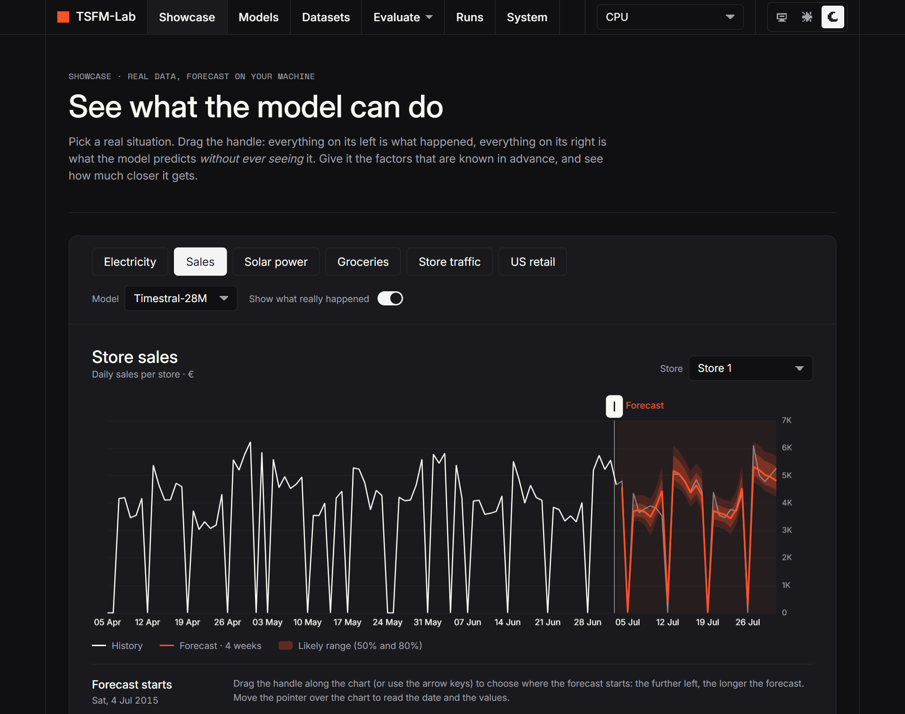
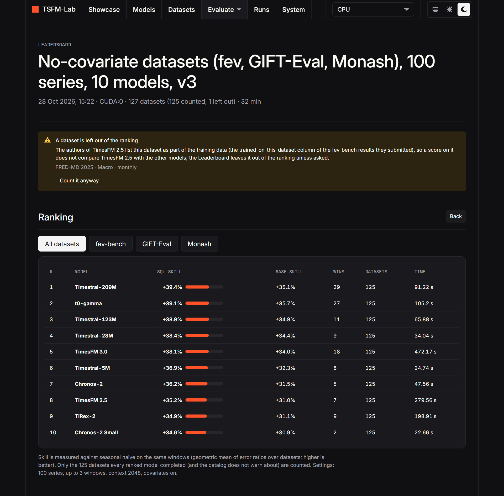
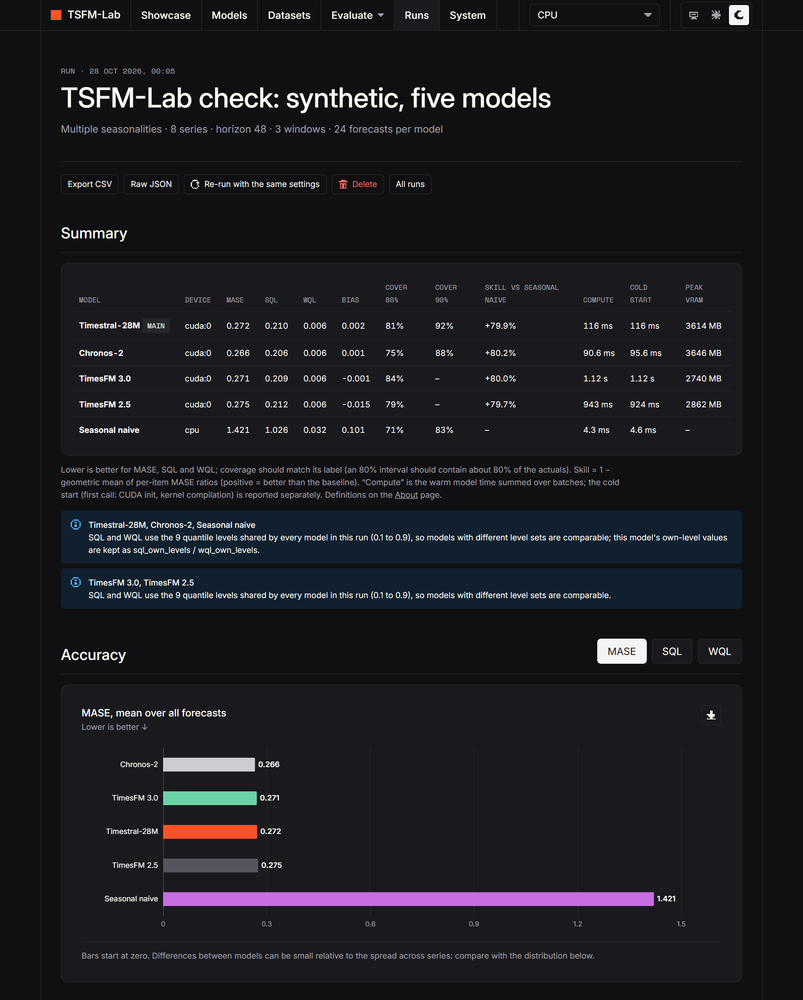

<h1 align="center">TSFM-Lab</h1>

<p align="center">
  <b>Run, compare and inspect time-series foundation models on your own machine.</b><br>
  Ten models from five families · 187 public benchmark datasets · your own data · CPU or GPU · nothing leaves your computer
</p>

<p align="center">
  <a href="LICENSE"></a>
  
  
  <a href="https://github.com/Leo00703/TSFM-Lab/actions/workflows/ci.yml"></a>
</p>

<p align="center">
  <picture>
    <source media="(prefers-color-scheme: light)" srcset="docs/images/showcase-light.png">
    
  </picture>
</p>

> **Unofficial.** This is an independent tool, not affiliated with or endorsed by Mistral AI, Amazon, Google, The Forecasting Company or NXAI.

Ten models run on the same data and are compared side by side: Mistral's [Timestral](https://github.com/mistralai/timestral) (5M / 28M / 123M / 209M),
Amazon's [Chronos-2](https://github.com/amazon-science/chronos-forecasting) (120M and 28M), Google's
[TimesFM](https://github.com/google-research/timesfm) 3.0 and 2.5, The Forecasting Company's
[t0-gamma](https://huggingface.co/theforecastingcompany/t0-gamma) and NXAI's [TiRex-2](https://github.com/NX-AI/tirex-2).
Any other model plugs in as one adapter file. They run entirely on your machine, on the CPU or a GPU (NVIDIA CUDA, Apple Metal), and every
result is shown with the measurements and configuration needed to judge it honestly.

## What you can do

- **See what a model does, in plain language.** The Showcase forecasts six real-data situations (electricity, store sales, solar power, groceries,
  store traffic, retail): drag the point where the forecast starts, read the likely range, and see how much the factors known in advance help.
- **Compare ten models on the same footing.** One forecast with every quantile (Playground), rolling-window backtests against simple baselines
  (Experiments), and a Leaderboard that ranks the models on a whole benchmark.
- **Test on 187 public datasets, scored the way fev-bench scores.** fev-bench, GIFT-Eval and the Monash archive, downloaded only when you ask,
  checked against their SHA-256. Datasets that a model's own authors list as training data are flagged and left out of the ranking by default.
- **Use your own data.** Add a CSV, Parquet or Excel file, backtest on it, or rank the models on your own datasets: data recorded after the models
  were trained is the cleanest test there is.
- **Inspect everything.** Every run stores its configuration, environment and raw forecasts: calibration, error by forecast step, spread across
  series, reproducibility, CSV export, and comparison of runs.
- **Keep it contained.** Everything the project installs or caches lives inside its folder; the server answers to local hosts only; weights are
  loaded from `safetensors` files only, never pickle.

<table>
  <tr>
    <td width="50%"><br><sub><b>Leaderboard.</b> Ten models on the same windows of 125 public datasets, scored against seasonal naive (a dataset the models' authors list as training data is left out, with a button to count it).</sub></td>
    <td width="50%"><br><sub><b>A run.</b> Every metric, the calibration of the uncertainty ranges, the error by forecast step, and the configuration needed to reproduce it.</sub></td>
  </tr>
</table>

### Results at a glance

Measured here, on a single GPU, 100 series per dataset, up to 3 windows each, with seasonal naive as the reference (skill: 0% matches it, +40% means
40% lower error). The details, the three rankings (without covariates, with covariates, the largest datasets), the uncertainty bars and the
caveats are in **[`RESULTS.md`](RESULTS.md)**.

- On **125 public datasets without covariates** (the 126 that count, minus `fred_md_2025--macro`, which TimesFM 2.5's authors list as training data:
  the Leaderboard's default view), Timestral-209M (+39.4%) and t0-gamma (+39.1%) lead and **cannot be told apart**, Timestral-123M
  (+38.9%) is just behind (counting all 126: +39.3%, +39.0% and +38.8%, the same order, as in the main table of `RESULTS.md`), and the small Timestral
  models hold up for their compute time (the 5M, in 25 seconds for the whole run, beats Chronos-2 small).
- With covariates the top three (t0-gamma, Timestral-209M, Timestral-123M) are again within noise of each other.
- These are public datasets and most makers do not list the real data their models were trained on, so read them as a comparison on equal footing,
  not as proof of out-of-sample skill; the clean test is your own recent data.

**Documentation:** [`RESULTS.md`](RESULTS.md) (measured results and caveats) · [`docs/BENCHMARKS.md`](docs/BENCHMARKS.md) (the online benchmarks and the Leaderboard score) ·
[`docs/SECURITY-MODEL.md`](docs/SECURITY-MODEL.md) · [`docs/RESOCONTO.md`](docs/RESOCONTO.md) (the development log, in Italian) · [`SECURITY.md`](SECURITY.md) · [`NOTICE`](NOTICE) (what the licence does and does not cover).

## Quick start

Requires **Python 3.12 or 3.13** (3.14 is not supported yet) and `git`. [`uv`](https://docs.astral.sh/uv/) is used if installed,
otherwise a private copy is installed inside the project. The first run downloads PyTorch (about 2.5 GB for the NVIDIA CUDA
build, a few hundred MB otherwise) and a few small tools; model weights are downloaded later, from the app, only when you ask.

**Windows**

```bash
python scripts/bootstrap.py
.venv\Scripts\python -m tsfm_lab serve
```

**macOS** (install a supported Python first if needed: `brew install python@3.13`; the system `python` command does not exist, use `python3.13`)

```bash
python3.13 scripts/bootstrap.py
.venv/bin/python -m tsfm_lab serve
```

**Linux**

```bash
python3 scripts/bootstrap.py          # python3.12 or python3.13
.venv/bin/python -m tsfm_lab serve
```

`serve` opens `http://127.0.0.1:8765` in your browser (add `--no-browser` to skip that, `--port N` to change the port).
`bootstrap.py` picks the PyTorch build for you: the CUDA build when an NVIDIA GPU is found, the small CPU build otherwise, the
standard macOS build on a Mac. Force one with `--device cpu`, `--device cuda` or `--device pypi`.

In every command below, `.venv\Scripts\python` is the Windows interpreter and `.venv/bin/python` the Linux/macOS one.

To check the installation:

```bash
.venv/bin/python scripts/doctor.py        # Windows: .venv\Scripts\python scripts/doctor.py
.venv/bin/python scripts/smoke_test.py    # downloads Timestral-5M (21 MB), checks shapes and quantile order,
                                          # then benchmarks every available device with warm-up and synchronisation
```

## Nothing is left behind

Everything the project installs or caches lives **inside this folder**: the virtual environment
(`.venv/`), model weights, datasets and every package/compiler cache (`.cache/`). Deleting the
folder removes it all. `scripts/leakcheck.py` proves it by comparing global cache locations
before and after an install.

| Script | Purpose |
|---|---|
| `scripts/bootstrap.py` | Create the environment, install PyTorch, `timestral` (pinned commit) and the Tailwind CLI (pinned checksum) |
| `scripts/doctor.py` | Versions, GPUs, disk usage, tool status |
| `scripts/smoke_test.py` | Run Timestral on every available device |
| `scripts/check_device_parity.py` | Compare a GPU with the CPU: same forecasts? how much faster? (`--device mps`, `--model timestral-28m`) |
| `scripts/leakcheck.py` | `--mark` before installing, `--report` after: verifies nothing was written elsewhere |
| `scripts/clean.py` | Remove `.venv` and/or `.cache` |
| `scripts/build_catalog.py` | Rebuild and verify the online-dataset catalog from the pinned sources (maintainers only; reads from Hugging Face, stores nothing) |
| `scripts/download_models.py` | Download Timestral weights without opening the app |
| `scripts/fetch_brand_assets.py` | Optional, off by default: fetch Mistral's font and logos for local private use (see Licences) |
| `scripts/fetch_vendor.py` | Re-fetch the two vendored JavaScript libraries (integrity-checked) |

## Models

| Family | Models | Licence | Covariates |
|---|---|---|---|
| Timestral (Mistral AI) | 209M, 123M, 28M, 5M | package Apache-2.0; weights "Modified MIT" with a US$20M monthly revenue limit | past, known-future, categorical |
| Chronos-2 (Amazon) | 120M, 28M ("small") | Apache-2.0 | past, known-future (numeric) |
| TimesFM 3.0 (Google) | 331M | code Apache-2.0; **weights non-commercial** (testing, evaluation, research only) | past, known-future (numeric) |
| TimesFM 2.5 (Google) | 231M | Apache-2.0 | none (univariate; covariates are ignored and the result says so) |
| t0-gamma (The Forecasting Company) | 256M | Apache-2.0 (a very young model: read its notes) | past, known-future (numeric) |
| TiRex-2 (NXAI) | 82M | Apache-2.0; one of its runtime libraries (`mlstm_kernels`) is under the NXAI Community Licence (free below EUR 100 million revenue, see its notes) | past, known-future (numeric), several variables together |

**Your own checkpoints.** The Models page can add a public Hugging Face repository (for example a fine-tune of a supported model) and run it
with the adapter of the model family you pick. This is deliberately narrow, not "run anything": the repository is inspected first (public,
a single `model.safetensors` plus `config.json`, at most 4 GB, licence shown), **only those two files are ever downloaded, at the exact commit
that was inspected**, so nothing in the repository can execute code (no pickle, no remote code) and a later push cannot change what runs.
Gated and private repositories are refused (the app holds no credentials). Context length, quantile levels and covariate support are taken
from the base model, which is right for a fine-tune of it and wrong for another architecture; you confirm that you understand these are
unverified third-party weights. Custom models appear on the Models page with a "custom checkpoint" tag and work everywhere a model does
(Playground, Experiments, Leaderboard); the list is kept in `data/user/custom_models.json` (git-ignored).

Weights are downloaded only when you ask, from the Models page (Chronos-2 is 478 MB, its small variant 112 MB, TimesFM 2.5 925 MB,
TimesFM 3.0 1.3 GB, t0-gamma 1 GB, TiRex-2 330 MB). **TimesFM 3.0's weights are under Google's non-commercial licence**: the card says so and asks you to
acknowledge it before downloading; do not use them for commercial or production purposes, and do not redistribute them. In the Playground
and in Experiments, choose a model and tick the others under "Compare with": they run on the same windows, with the same metrics.
Chronos-2 and t0-gamma use the same 21 quantile levels as Timestral; both TimesFM models and TiRex-2 produce nine deciles (0.1 to 0.9). When models with
different levels run in one backtest, **SQL and WQL are computed for every model on the levels they all share**, so those scores
(and the skill scores built on them) stay comparable; each model's own-level values are kept alongside, and the 90% and 98%
interval coverage is only reported for models that predict those tails. Timestral's options map to the closest equivalent
(symmetric averaging, keeping non-negative inputs non-negative) for TimesFM and are ignored by Chronos-2.

Adding a model means writing one `ModelAdapter` (see `src/tsfm_lab/models/chronos.py` for a short example built on the shared
`TorchAdapter`, which already handles device choice, the CPU fallback and memory release) and one manifest per checkpoint.

## Platforms and compute devices

| Platform | Compute | Notes |
|---|---|---|
| Windows | CPU, NVIDIA CUDA | Developed and tested here, including the GPU |
| Linux | CPU, NVIDIA CUDA | Installation and tests pass on a hosted Linux runner (CPU); CUDA on Linux is not tested by the author |
| macOS (Apple Silicon) | CPU, Apple GPU (MPS) | Installation and tests pass on a hosted macOS runner; the Apple GPU was verified on a MacBook Air M5 (see below) |

You choose the device from the selector at the top right of the app, at any time, even when a GPU is present. The default is
the CPU on every system. **If the chosen GPU is missing, fails to load, or fails while forecasting, the app continues on the
CPU without an error and says so in the result's warnings.** The CPU-vs-GPU benchmark on the System page is the one exception:
it fails instead of labelling CPU numbers as GPU numbers.

**Apple GPU.** The official `timestral` package cannot use Apple's GPU because it computes in float64, which Metal lacks
([upstream issue #6](https://github.com/mistralai/timestral/issues/6)). On macOS only, `pyproject.toml` therefore pins a
one-commit fork of the very same upstream commit that runs those float64 statistics on the CPU
([`paschembri/timestral@c49d40f`](https://github.com/paschembri/timestral/commit/c49d40f08dc75c05d7489a3ef26fb3fd565584c7)).
The change was reviewed before being pinned (3 files, no new dependency, no network, process or file access) and the pin is
by commit hash, so it cannot change underneath you. Windows and Linux use the official repository. Measured on a MacBook Air M5:
the GPU gives the same forecasts as the CPU (relative difference below 5e-5) and is about 1.3 times faster on the 209M model,
so it is an option, not the default. Check your own machine with
`.venv/bin/python scripts/check_device_parity.py --device mps --model timestral-28m --series 64`.

## Web app

Pages: **Showcase** (home), Models (download weights, specs, your own checkpoints), Datasets (your own files, online benchmarks, bundled
scenarios), Playground (one forecast, all quantiles), Experiments (rolling-window backtests against baselines), Leaderboard (several models on
a whole benchmark), Runs (every metric, calibration, per-step error, reproducibility, comparison of runs), System (CPU vs GPU benchmark,
disk use), About (licences, definitions). Long jobs (experiments, benchmarks, downloads,
measurements) run in the background, survive navigation and reloads, and can be stopped from the Activity panel.

Dark by default with a light theme switch, responsive down to phone width, English only. Inference runs in a separate worker
process, so a PyTorch/CUDA/Metal crash cannot take the server down. The UI is built with Tailwind (standalone CLI installed by
`bootstrap.py`) and plain JavaScript, with Preact and ECharts vendored.

**From your other devices (Tailscale):** `python -m tsfm_lab serve --tailscale` listens on loopback and your tailnet address
only. There is no login, so anyone on your tailnet can use it.

### Online benchmarks

The Datasets page lists **187 curated datasets** from three public benchmarks (fev-bench, GIFT-Eval and the Monash archive), none of them
downloaded until you ask, each one checked against a SHA-256 before use. The **Leaderboard** runs several models on a whole benchmark, or on your
own datasets, and ranks them by skill against seasonal naive; a dataset that a ranked model's authors list as training data is flagged and left
out by default. How the catalogues were built, how the score works and what the contamination notes say: **[`docs/BENCHMARKS.md`](docs/BENCHMARKS.md)**.

### Showcase data

The Showcase downloads small public datasets from Hugging Face (`autogluon/fev_datasets`, pinned revision) the first time you
open a scenario, after asking: electricity demand, store sales, solar power, online grocery sales, supermarket traffic and US
retail items. The repository card declares the licence as "other" and the data come from public sources: check their terms
before reusing the data. Nothing from your own files or runs is ever uploaded.

## Command line

```bash
.venv/bin/python -m tsfm_lab models        # registered models          (Windows: .venv\Scripts\python -m tsfm_lab ...)
.venv/bin/python -m tsfm_lab devices       # CPU / GPU devices and whether each is usable
.venv/bin/python -m tsfm_lab datasets      # bundled synthetic scenarios
.venv/bin/python -m tsfm_lab run --model timestral-5m --dataset multi_seasonality --device cuda --horizon 48
.venv/bin/python -m tsfm_lab run --model timestral-28m --dataset file:my_data.csv --targets sales
.venv/bin/python -m tsfm_lab runs          # stored runs
```

`run` backtests the model and the baselines on identical rolling windows and stores the run under `runs/`.
To add a model, write one `ModelAdapter` and register it (see `src/tsfm_lab/models/`).

## Security

The app is built to be safe to leave running on your own machine, and to say plainly where it is not. It listens on `127.0.0.1` only and refuses
requests from other hosts and origins; with `--tailscale` it also listens on your tailnet address and **there is no login**, so anyone on your
tailnet can use the app and see your runs and datasets. Weights are loaded from `safetensors` files only (never pickle), nothing from outside is
executed, uploads are limited and sanitised, and inference runs in a separate process. What is protected, what is not (a malicious file that
exploits a bug in `pandas`, `pyarrow` or `openpyxl`) and why: **[`docs/SECURITY-MODEL.md`](docs/SECURITY-MODEL.md)**. To report a vulnerability, see
[`SECURITY.md`](SECURITY.md).

## Development

```bash
.venv/bin/python -m pytest        # Windows: .venv\Scripts\python -m pytest   (no model weights needed; about a minute on a laptop CPU)
.venv/bin/ruff check .            # Windows: .venv\Scripts\ruff check .      (clean; the code is not auto-formatted, so do not run `ruff format`)
```

Set `CUDA_VISIBLE_DEVICES=""` to keep the tests off the GPU. `tests/test_ui_smoke.py` opens every page of the interface in a real browser (an installed
Chrome or Edge, driven by Playwright) and fails on the first script error; it is skipped where there is no such browser. The styles are built by the app itself when it starts (`web/src/app.css` into
`web/dist/app.css`, with the pinned Tailwind CLI); the JavaScript is plain modules, so there is no build step.
`src/tsfm_lab/` holds `models/` (adapters and manifests), `data/` (loaders, catalogs), `eval/` (backtests, metrics, the leaderboard),
`api/` (FastAPI app, jobs, the worker process), `store/` (runs on disk), `showcase/` and `system/`; `web/` is the interface and `tests/` the tests.
Contributions are welcome: see [`CONTRIBUTING.md`](CONTRIBUTING.md).

## Continuous integration

`.github/workflows/ci.yml` ("Cross-platform check") runs Linux, Windows and macOS through the reusable `check.yml` (one system). It runs
on every push to `main` and every pull request that touches code (documentation-only changes are skipped), and by hand from the Actions tab
(Run workflow) or with `gh workflow run ci.yml -f systems=macos` (or `all`, `linux`, `windows`). Each system runs the real
installation (`scripts/bootstrap.py`), the environment report, `ruff check .`, the tests without model weights, and the tests with the real
Timestral-5M checkpoint on the CPU. Hosted runners have no GPU, so the GPU paths are checked by hand. The workflow uses no secrets and
only reads the repository.

## Licences and third-party material

- The `timestral` Python package is Apache-2.0. The **model weights** are under Mistral's
  "Modified MIT" licence, which withholds all rights if your company's (or employer's) global
  consolidated **monthly** revenue exceeds US$20 million. Read it before use:
  <https://huggingface.co/mistralai/Timestral-209M/blob/main/LICENSE>. Weights are downloaded
  at run time and are never part of this repository.
- Mistral's brand assets (the ALTMistral font and the Timestral logos) belong to Mistral AI.
  They are **not** in this repository, and nothing fetches them unless you ask: `scripts/fetch_brand_assets.py` (or
  `bootstrap.py --brand-assets`) downloads them, from the public URLs Mistral's own sites serve, to the git-ignored
  `web/assets/mistral/` for local private use only. Without them the UI uses Inter and a built-in mark, as in the pictures above.
- Inter and Space Mono (`web/fonts/`) are licensed under the SIL Open Font License.
- This project's own code is licensed under the Apache License 2.0 (see [`LICENSE`](LICENSE) and [`NOTICE`](NOTICE)); the licence covers
  the code only, not the model weights, the datasets, the vendored libraries or the brand assets above, which keep their own terms.
